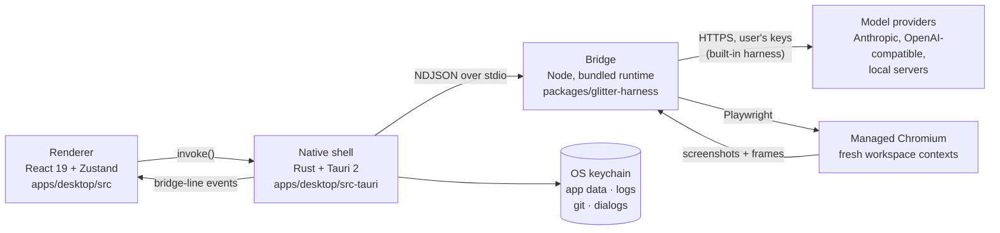

# Architecture

Glitter is a coding-agent app with its own agent harness. The
built-in **Harness** agent calls model providers directly with the user's own
keys and runs its tools inside the workspace (see `packages/glitter-harness/src/harness`).
Harness is the only agent runtime. Glitter no longer starts external Muse or
ACP agent CLIs. Their session histories remain in their own data directories.

## Processes

| Process | Entry point | Responsibility |
|---|---|---|
| Renderer (OS webview) | `apps/desktop/src/main.tsx` → `App.tsx` | All UI. One Zustand store. Talks only to the native shell. |
| Native shell | `apps/desktop/src-tauri/src/main.rs` → `lib.rs::run()` | Trust boundary. Validates every renderer request, owns workspace grants, credentials, git, dialogs, files, logs, and the bridge child process. |
| Bridge | `packages/glitter-harness/src/index.ts` (bundled to `dist/index.js`) | Line-delimited JSON RPC on stdio. Runs `HarnessHost` and forwards its events. |
| Managed Chromium | Started by `browser.ts` through Playwright | One fresh incognito context and page per workspace root. Agent tools and panel input share its operation queue. The renderer receives raster frames and plain text, never remote DOM. |

## The renderer is untrusted

The native shell treats the webview as possibly compromised:

- **Allowlisted verbs.** `bridge_request` relays only the methods in
  `BRIDGE_METHODS` (`lib.rs`). Each one's params are deserialized into a typed
  DTO (`dto.rs`) with `deny_unknown_fields`, closed enums and size caps.
  Oversized IPC bodies are rejected before any DTO runs.
- **Workspace grants.** A folder can only be used after the user picks it in the
  native folder picker. That mints a grant (`wg-<uuid>`), stored in the OS
  keyring. Session, git, open and export calls carry a grant id, and the shell
  injects the canonical root path itself. Bridge responses are checked to bind
  session → grant and approval → session, so later calls can't point at
  someone else's session. The one derived grant is for a worktree the shell
  itself creates for a thread, inside its own store, from a repository that is
  already granted (see [DECISIONS.md](DECISIONS.md)).
- **Credentials never reach the renderer.** Provider status returns masks. The
  real API key is added to bridge params by the native side (`credentials.rs`).
- **Browser launch is native-authorized.** The shell chooses a compatible
  Chromium, validates its executable identity and supplies its canonical path
  and digest to the bridge. The renderer cannot nominate a binary, profile or
  CDP endpoint. Browser verbs require a live workspace grant; revocation closes
  the associated context. Production always enables Chromium's sandbox.
- **Release builds verify the bridge.** `build.rs` bakes the SHA-256 of
  `packages/glitter-harness/dist/index.js` into the binary, and the packaged script
  is checked before it runs. The bridge runs on a bundled Node runtime (the
  `glitter-node` sidecar staged by `packages/glitter-harness/scripts/stage-sidecar.mjs`),
  never on the user's Node.

The bridge applies its own isolation (`isolation.ts`). Child processes get
filtered environments and a confined working directory. Harness shell commands
and stdio MCP servers use the macOS seatbelt write sandbox when available;
permission decisions remain in the Harness pipeline.
Process trees are killed on cancel by signalling their process group. Approvals expire after 10 minutes. Request queues and frame sizes are
bounded. Diagnostics are redacted in both the bridge (`redaction.ts`) and the
shell before they're logged.

## Request and event flow

1. **Startup.** The window opens as soon as local state loads (`store.ts`
   hydrate). Agent detection, `startHost`, thread listing and restoring the last
   thread then run in the background.
2. **Request.** A component calls a store action. The action calls `bridge.ts`,
   which calls `invoke("bridge_request", { method, params })`, or a dedicated
   Tauri command for git, files, dialogs, skills/plugins, credentials and logs.
   Those dedicated commands never pass through the bridge.
3. **Relay.** The shell validates the request, injects grants and credentials,
   and writes one JSON line to the bridge's stdin. `index.ts` dispatches the call
   to the Harness host.
4. **Streaming.** Hosts emit events (`item`, `delta`, `approval`,
   `turnCompleted`, `sessionFacts`, …). `delta` frames are merged for up to one
   frame in `output.ts`. The shell re-emits every line as a `bridge-line` Tauri
   event.
5. **State.** `bindBridgeEvents` (`store.ts`) applies events to the store, again
   merging deltas per animation frame. Components subscribe through narrow
   `useShallow` selectors, so streaming re-renders only the active block
   (`markdownBlocks.ts`).
6. **Decisions.** Approvals and user-input questions show as cards. The user's
   choice goes back as `decideApproval` / `respondUserInput`.

The protocol types the renderer and bridge share live in
`packages/glitter-harness/src/protocol.ts`, which the renderer imports directly.

## State and persistence

| Data | Where | Owner |
|---|---|---|
| UI state, threads, transcripts in view | Zustand store (`useAppStore`, `apps/desktop/src/lib/store.ts`) | Renderer |
| Settings (`DEFAULT_SETTINGS` in `types.ts`) and session memory (drafts, titles, pins, layout) | `glitter.json` in the app data dir, written atomically by the native `persist_store_atomic` (temp file + rename, `.bak` kept, corrupt file quarantined) | `settingsPersistence.ts`, `sessionMemory.ts` |
| Provider keys (BYOK), workspace grants | OS keyring, service `com.glitter.desktop` | `credentials.rs`, `lib.rs` |
| App and security logs | OS log dir (`glitter.log`, `security-audit.log`) | `lib.rs`, `logger.ts` |
| Session history | JSONL files in `<app data>/harness` (`GLITTER_HARNESS_DIR`) | `harness/store.ts` |
| Data of a Muse Code install (bundle id `com.musecode.desktop`) | Moved into the folders and keychain service above on first launch; its worktrees stay in its old data folder | `legacy.rs` |

There's no router. `App.tsx` shows onboarding or the main shell (sidebar,
thread view, review dock) and mounts the modal surfaces.

## Browser preview mode

If the renderer isn't running inside Tauri (`isTauri()` is false), `bridge.ts`
answers from `lib/mock.ts` instead of calling native code. `npm run dev:ui` uses
this for UI work without Rust or a CLI. The website's screenshot script
(`apps/website/scripts/capture.mjs`) uses it too. Dev-only URL flags:
`?boot=1` (boot screen), `?usage=preview`.

## Controlled Browser

This is separate from the mock browser preview above. `browser.ts` in the bridge
owns one Playwright `BrowserManager`, shared by the built-in Harness's `browser`
tool and the renderer's `browserOpen` / `browserControl` / `browserClose` verbs.
Each workspace or worktree root gets a fresh, non-persistent incognito context
with one page, disabled downloads, blocked service workers and http(s)-only
navigation. The renderer's `BrowserPane` shows JPEG frames at 5 fps only while
visible and forwards pointer/keyboard input through the same per-root queue.

Read actions (snapshot, screenshot, console, scroll and wait) do not prompt.
Navigation and page-changing actions require an origin grant in Ask and Auto;
the origin is checked again after an approval wait. Full access bypasses prompts,
while Plan mode keeps the browser read-only. Explicit screenshots travel as
image content to the selected model provider. Older images leave the request
view with an omission note, and bulky image bytes are not persisted in session
JSONL. Playwright's package and registry metadata are embedded by
`scripts/playwright-metadata.mjs`, so the packaged single-file bridge needs no
`node_modules` directory. Chromium is installed separately; Glitter does not
bundle a browser binary.

## Module map

### `apps/desktop/src` (renderer)

- `App.tsx`: shell layout, global shortcuts, modal mounting.
- `components/`: one file per surface. Main views: `Sidebar`, `ThreadView`
  (`AgentTimeline`, `Composer`, `ApprovalCard`, `UserInputCards`), `ReviewDock`
  (`TaskMonitor`), `SettingsModal` (lazy; it loads `ExtensionsView` and
  `UsageView`), `BrowserPane` (shared Chromium view and controls). The rest
  are pickers, dialogs and visuals (`Orb`, `ModelPicker`, `EffortPicker`).
- `lib/store.ts`: the single store, with all actions and the bridge event
  binding.
- `lib/bridge.ts`: every `invoke` call and the preview mock fallback.
- `lib/types.ts`: domain types and `DEFAULT_SETTINGS`.
- Pure helpers, each unit-tested from `tests/`: `agent.ts` (timeline grouping),
  `composerText.ts`, `diff.ts`, `drop.ts`, `effort.ts`, `errors.ts`, `format.ts`,
  `fuzzy.ts`, `markdownBlocks.ts`, `approvalPreview.ts`.
- Platform helpers: `logger.ts` (redacted app log), `notify.ts`, `haptics.ts`,
  `theme.ts`, `settingsPersistence.ts`, `sessionMemory.ts`.
- `test/`: Vitest setup and store seeding for DOM tests.

### `apps/desktop/src-tauri/src` (native shell)

- `lib.rs`: Tauri builder, commands, bridge supervision and respawn, grants,
  git, menu, logging, and the mock-app native end-to-end tests.
- `snapshots.rs`: per-turn file states, Undo and Reapply.
- `worktrees.rs`: per-thread git worktrees (create, remove, branch cleanup).
- `terminal.rs`: PTY shells behind the terminal pane.
- `dto.rs`: typed validation for each bridge method.
- `exec.rs`: executable resolution, validation and digest pinning.
- `process.rs`: child-process environment and process-group shutdown.
- `framing.rs`: bounded NDJSON reader.
- `credentials.rs`: keyring access.
- `legacy.rs`: the one-time carry-over of a Muse Code install.

### `packages/glitter-harness/src` (bridge)

- `index.ts`: stdio dispatch to Harness. `cli.ts` drives the same host from a
  terminal and shares the app's local provider credentials and session store.
- `browser-types.ts`: renderer-safe browser protocol; `browser.ts`: the shared
  Playwright manager, Harness browser extension, native-pinned launch, fresh
  contexts, action validation, screenshots and visible-panel streaming.
- `harness/`: the built-in agent. `providers.ts` (catalog, keys, effort tiers),
  `wire.ts` (streaming Anthropic Messages and OpenAI-compatible Chat
  Completions), `tools.ts` (workspace-confined read, list, grep, write, edit, a
  sandboxed shell and the plan checklist, as `BUILTIN_TOOLS`), `registry.ts`
  (`ExtensionRegistry`: the tools, prompt sections and hooks a turn snapshots
  when it starts), `permission/` (the shell reader, the read-only classifier,
  the danger rules, thread grants, the ask-policy and deny-only guards),
  `skills.ts` (`SKILL.md` discovery, the per-turn catalog and the `skill`
  tool), `questions.ts` (`ask_user`, `exit_plan_mode` and the question a turn ends
  with),
  `store.ts` (JSONL sessions) and `host.ts` (`HarnessHost`:
  the agent loop, approvals and the bridge events).
- `isolation.ts`, `redaction.ts`, `framing.ts`, `output.ts`,
  `protocol.ts`: hardening, transport and shared types.

### `apps/website`

A static marketing site (Vite, three.js, Lenis). It shares no code with the
desktop app. See `apps/website/README.md`.

## Constraints to preserve

- The Harness session log is the source of truth. Don't simulate agent behavior, invent
  reasoning, or keep a second copy of session history.
- Every privileged action is authorized natively. Adding a renderer feature that
  touches files, processes or credentials means adding a native command or
  bridge verb with a DTO, not widening an existing one.
- Six manifests carry the app version. `npm run check:versions` enforces this.
