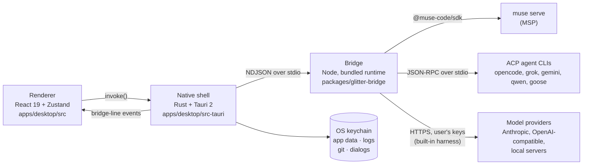

# Architecture

Glitter is a coding-agent app with its own agent harness. The
built-in **Harness** agent calls model providers directly with the user's own
keys and runs its tools inside the workspace (see `packages/glitter-bridge/src/harness`).
The app also drives external agent CLIs: the official `muse` CLI and supported
third-party ACP agents, which do their own work while the app starts them, shows
their output and forwards the user's decisions.

The harness is the direction of travel: the goal is an independent harness that
needs no agent CLI installed. External CLIs stay supported side by side.

## Processes

| Process | Entry point | Responsibility |
|---|---|---|
| Renderer (OS webview) | `apps/desktop/src/main.tsx` → `App.tsx` | All UI. One Zustand store. Talks only to the native shell. |
| Native shell | `apps/desktop/src-tauri/src/main.rs` → `lib.rs::run()` | Trust boundary. Validates every renderer request, owns workspace grants, credentials, git, dialogs, files, logs, and the bridge child process. |
| Bridge | `packages/glitter-bridge/src/index.ts` (bundled to `dist/index.js`) | Line-delimited JSON RPC on stdio. Runs the built-in `HarnessHost`, one `MuseHost` (MSP via the SDK) and one `AcpAgentHost` per third-party agent, and turns their streams into one event vocabulary. |
| `muse serve` | Started by `host.ts` | The real agent: sessions, turns, tools, approvals, models, usage. |

## The renderer is untrusted

The native shell treats the webview as possibly compromised:

- **Allowlisted verbs.** `bridge_request` relays only the methods in
  `BRIDGE_METHODS` (`lib.rs`). Each one's params are deserialized into a typed
  DTO (`dto.rs`) with `deny_unknown_fields`, closed enums and size caps.
  Oversized IPC bodies are rejected before any DTO runs.
- **Workspace grants.** A folder can only be used after the user picks it in the
  native folder picker. That mints a grant (`wg-<uuid>`), stored in the OS
  keyring. Session, git, open and export calls carry a grant id, and the shell
  injects the canonical root path itself. Bridge responses are checked to bind
  session → grant and approval → session, so later calls can't point at
  someone else's session. The one derived grant is for a worktree the shell
  itself creates for a thread, inside its own store, from a repository that is
  already granted (see [DECISIONS.md](DECISIONS.md)).
- **Credentials never reach the renderer.** `credential_get` returns a mask. The
  real API key is added to bridge params by the native side (`credentials.rs`).
- **Executable identity.** Agent binaries are canonicalized and validated, then
  pinned by digest. Third-party ACP agents also need an explicit, keyring-stored
  isolation consent (`exec.rs`).
- **Release builds verify the bridge.** `build.rs` bakes the SHA-256 of
  `packages/glitter-bridge/dist/index.js` into the binary, and the packaged script
  is checked before it runs. The bridge runs on a bundled Node runtime (the
  `glitter-node` sidecar staged by `packages/glitter-bridge/scripts/stage-sidecar.mjs`),
  never on the user's Node.

The bridge applies its own isolation (`isolation.ts`). Child processes get
filtered environments and a confined working directory. ACP agents run under
the seatbelt write sandbox (`sandbox-exec`); when it is unavailable the user
must opt in before the agent starts. The Muse MSP host starts directly: Muse owns shell
sandboxing and approvals according to each session's permission mode.
Diagnostics report its sandbox as `cli-managed`, without asserting that an
Unrestricted session is sandboxed. An outer write sandbox would prevent Muse's
shell children from applying their own sandbox.
Process trees are killed on cancel by signalling their process group. Approvals expire after 10 minutes. Request queues and frame sizes are
bounded. Diagnostics are redacted in both the bridge (`redaction.ts`) and the
shell before they're logged.

## Request and event flow

1. **Startup.** The window opens as soon as local state loads (`store.ts`
   hydrate). Agent detection, `startHost`, thread listing and restoring the last
   thread then run in the background.
2. **Request.** A component calls a store action. The action calls `bridge.ts`,
   which calls `invoke("bridge_request", { method, params })`, or a dedicated
   Tauri command for git, files, dialogs, skills/plugins, credentials and logs.
   Those dedicated commands never pass through the bridge.
3. **Relay.** The shell validates the request, injects grants and credentials,
   and writes one JSON line to the bridge's stdin. `index.ts` sends the call to
   the host that owns the session (a `sessionId → agentId` map).
4. **Streaming.** Hosts emit events (`item`, `delta`, `approval`,
   `turnCompleted`, `sessionFacts`, …). `delta` frames are merged for up to one
   frame in `output.ts`. The shell re-emits every line as a `bridge-line` Tauri
   event.
5. **State.** `bindBridgeEvents` (`store.ts`) applies events to the store, again
   merging deltas per animation frame. Components subscribe through narrow
   `useShallow` selectors, so streaming re-renders only the active block
   (`markdownBlocks.ts`).
6. **Decisions.** Approvals and user-input questions show as cards. The user's
   choice goes back as `decideApproval` / `respondUserInput`.

The protocol types the renderer and bridge share live in
`packages/glitter-bridge/src/protocol.ts`, which the renderer imports directly.

## State and persistence

| Data | Where | Owner |
|---|---|---|
| UI state, threads, transcripts in view | Zustand store (`useAppStore`, `apps/desktop/src/lib/store.ts`) | Renderer |
| Settings (`DEFAULT_SETTINGS` in `types.ts`) and session memory (drafts, titles, pins, layout) | `glitter.json` in the app data dir, written atomically by the native `persist_store_atomic` (temp file + rename, `.bak` kept, corrupt file quarantined) | `settingsPersistence.ts`, `sessionMemory.ts` |
| API key, provider keys (BYOK), workspace grants, agent digest pins, ACP consent | OS keyring, service `com.glitter.desktop` | `credentials.rs`, `lib.rs` |
| App and security logs | OS log dir (`glitter.log`, `security-audit.log`) | `lib.rs`, `logger.ts` |
| Session history | The agent CLI's own data directory; for the built-in harness, JSONL files in `<app data>/harness` (`GLITTER_HARNESS_DIR`) | Muse / ACP agent / `harness/store.ts` |
| Data of a Muse Code install (bundle id `com.musecode.desktop`) | Moved into the folders and keychain service above on first launch; its worktrees stay in its old data folder | `legacy.rs` |

There's no router. `App.tsx` shows onboarding or the main shell (sidebar,
thread view, review dock) and mounts the modal surfaces.

## Browser preview mode

If the renderer isn't running inside Tauri (`isTauri()` is false), `bridge.ts`
answers from `lib/mock.ts` instead of calling native code. `npm run dev:ui` uses
this for UI work without Rust or a CLI. The website's screenshot script
(`apps/website/scripts/capture.mjs`) uses it too. Dev-only URL flags:
`?boot=1` (boot screen), `?usage=preview`.

## Module map

### `apps/desktop/src` (renderer)

- `App.tsx`: shell layout, global shortcuts, modal mounting.
- `components/`: one file per surface. Main views: `Sidebar`, `ThreadView`
  (`AgentTimeline`, `Composer`, `ApprovalCard`, `UserInputCards`), `ReviewDock`
  (`TaskMonitor`), `SettingsModal` (lazy; it loads `ExtensionsView`, `UsageView`
  and `LoginPanel`). The rest are pickers, dialogs and visuals (`Orb`,
  `ModelPicker`, `EffortPicker`).
- `lib/store.ts`: the single store, with all actions and the bridge event
  binding.
- `lib/bridge.ts`: every `invoke` call and the preview mock fallback.
- `lib/types.ts`: domain types and `DEFAULT_SETTINGS`.
- Pure helpers, each unit-tested from `tests/`: `agent.ts` (timeline grouping),
  `composerText.ts`, `diff.ts`, `drop.ts`, `effort.ts`, `errors.ts`, `format.ts`,
  `fuzzy.ts`, `markdownBlocks.ts`, `approvalPreview.ts`, `agentSwitch.ts`.
- Platform helpers: `logger.ts` (redacted app log), `notify.ts`, `haptics.ts`,
  `theme.ts`, `settingsPersistence.ts`, `sessionMemory.ts`.
- `test/`: Vitest setup and store seeding for DOM tests.

### `apps/desktop/src-tauri/src` (native shell)

- `lib.rs`: Tauri builder, commands, bridge supervision and respawn, grants,
  git, menu, logging, and the mock-app native end-to-end tests.
- `snapshots.rs`: per-turn file states, Undo and Reapply.
- `worktrees.rs`: per-thread git worktrees (create, remove, branch cleanup).
- `terminal.rs`: PTY shells behind the terminal pane.
- `dto.rs`: typed validation for each bridge method.
- `exec.rs`: executable resolution, validation and digest pinning.
- `process.rs`: child-process environment and process-group shutdown.
- `framing.rs`: bounded NDJSON reader.
- `credentials.rs`: keyring access.
- `legacy.rs`: the one-time carry-over of a Muse Code install.

### `packages/glitter-bridge/src` (bridge)

- `index.ts`: stdio dispatch and agent routing.
- `harness/`: the built-in agent. `providers.ts` (catalog, keys, effort tiers),
  `wire.ts` (streaming Anthropic Messages and OpenAI-compatible Chat
  Completions), `tools.ts` (workspace-confined read, list, grep, write, edit, a
  sandboxed shell and the plan checklist, as `BUILTIN_TOOLS`), `registry.ts`
  (`ExtensionRegistry`: the tools, prompt sections and hooks a turn snapshots
  when it starts), `permission/` (the shell reader, the read-only classifier,
  the danger rules, thread grants, the ask-policy and deny-only guards),
  `skills.ts` (`SKILL.md` discovery, the per-turn catalog and the `skill`
  tool), `questions.ts` (`ask_user`, `exit_plan_mode` and the question a turn ends
  with),
  `store.ts` (JSONL sessions) and `host.ts` (`HarnessHost`:
  the agent loop, approvals and the bridge events).
- `host.ts`: `MuseHost`, which handles MSP sessions, turns, approvals, models
  and usage.
- `acp.ts`: `AcpAgentHost`, which translates ACP `session/update` into bridge
  events. Models come from session config options or initialization metadata.
  A catalog request before a user thread creates a temporary, prompt-free ACP
  session in the confined temporary directory and closes it when supported. Rescan
  bypasses the cached catalog; a new agent process invalidates it. The older
  OpenCode CLI catalog is only a fallback for agents without session discovery.
- `agents.ts`: the agent registry (`AGENTS`) and detection. `detect.ts` resolves
  the `muse` binary and its auth.
- `login.ts`: in-app `muse login` device-code flow. `cli-update.ts`: Muse CLI
  release-channel checks.
- `isolation.ts`, `redaction.ts`, `framing.ts`, `output.ts`,
  `probe-cache.ts`: hardening and transport.
- `efforts.ts`, `session-facts.ts`, `user-input.ts`, `protocol.ts`: protocol
  adapters and shared types.

Muse subscriber Contributor mode is separate from model selection. Settings →
Models can explicitly pass `--contributor-mode on|off` to `muse serve`; the
default omits the flag and preserves the CLI's own preference. This is a host
construction setting and waits for Save & restart connection. Catalog rows
and any legacy pay-as-you-go Contributor model IDs still come from the CLI.

### `apps/website`

A static marketing site (Vite, three.js, Lenis). It shares no code with the
desktop app. See `apps/website/README.md`.

## Constraints to preserve

- The CLI is the source of truth. Don't simulate agent behavior, invent
  reasoning, or keep a second copy of session history.
- Every privileged action is authorized natively. Adding a renderer feature that
  touches files, processes or credentials means adding a native command or
  bridge verb with a DTO, not widening an existing one.
- `@muse-code/sdk` is pinned exactly (`packages/glitter-bridge/package.json`). The
  pin and `BRIDGE_SDK_VERSION` in `host.ts` move together, and a test checks the
  installed SDK version. At handshake the SDK's schema fingerprint is compared
  with the one the CLI serves, and any mismatch shows under Settings →
  Diagnostics.
- Six manifests carry the app version. `npm run check:versions` enforces this.
- Third-party ACP agents stay off by default.
